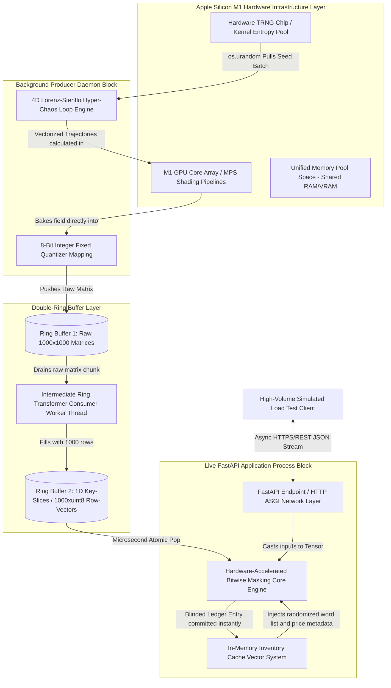
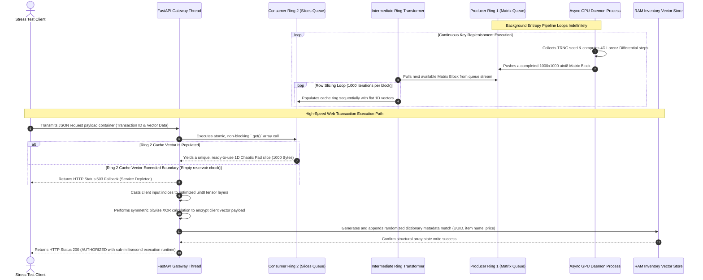
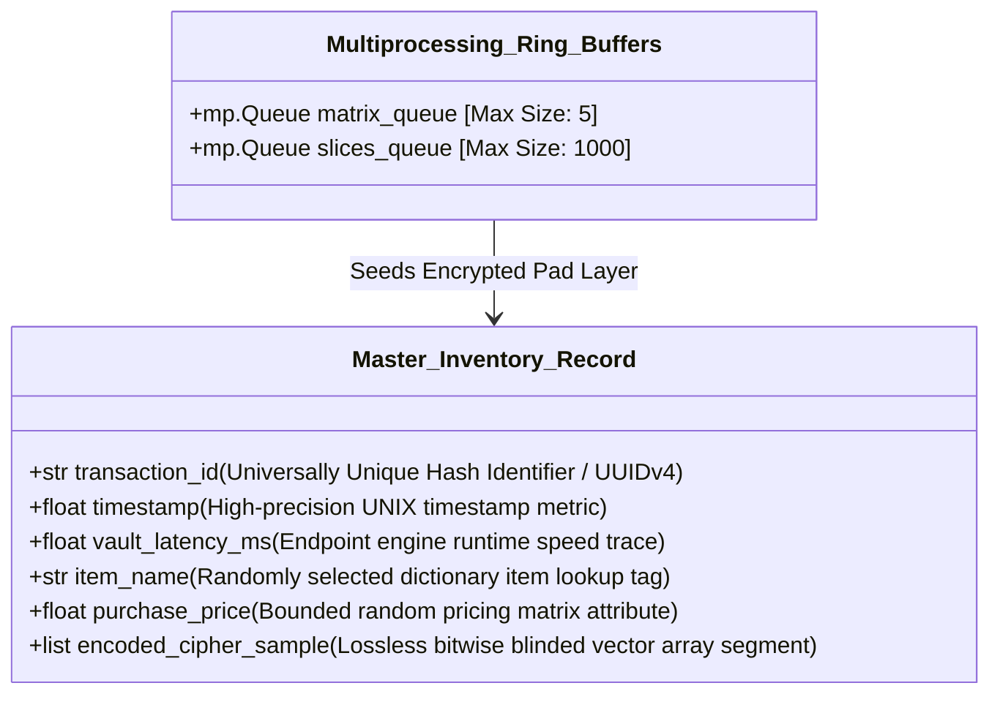

# High-Performance Quantum-Resistant Dual-Ring Ledger Architecture

This document maps out the system topology and runtime sequence for the GPU-accelerated decoupled chaos masking engine. 

---

## 1. System Components & Boundary Mappings

The engine isolates slow, complex mathematical generation steps from the microsecond critical path of live HTTP transaction processing using an independent multi-process architecture.

---

## 2. Comprehensive Thread Data Lifecycle & Sequential Workflows

This chart illustrates how an incoming payment payload request is processed seamlessly by extracting cached key vectors without ever waiting for the GPU chaos engine to loop.

---

## 3. Data Schema & Memory Layout Specifications

The format used inside the volatile in-memory dictionary data layers eliminates standard indexing locks entirely:

